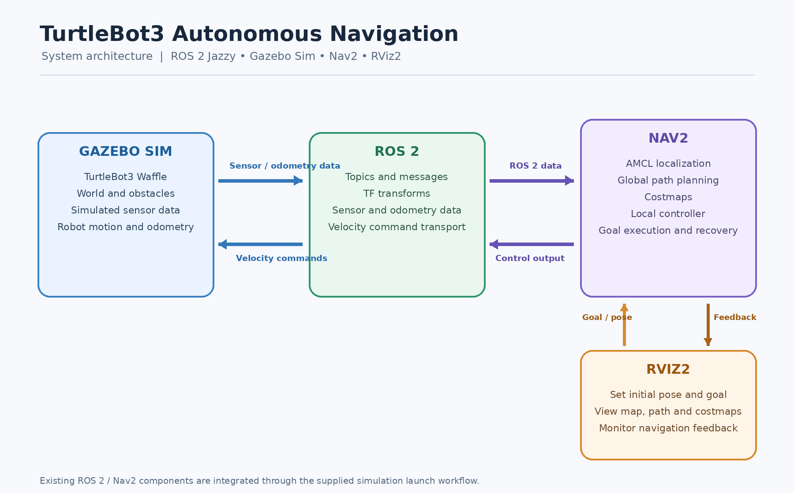
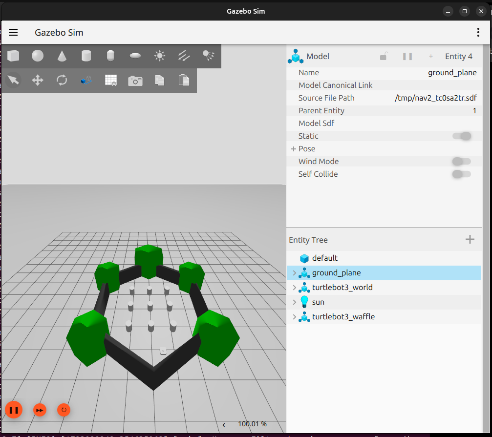
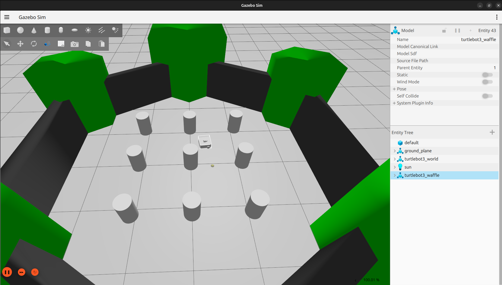
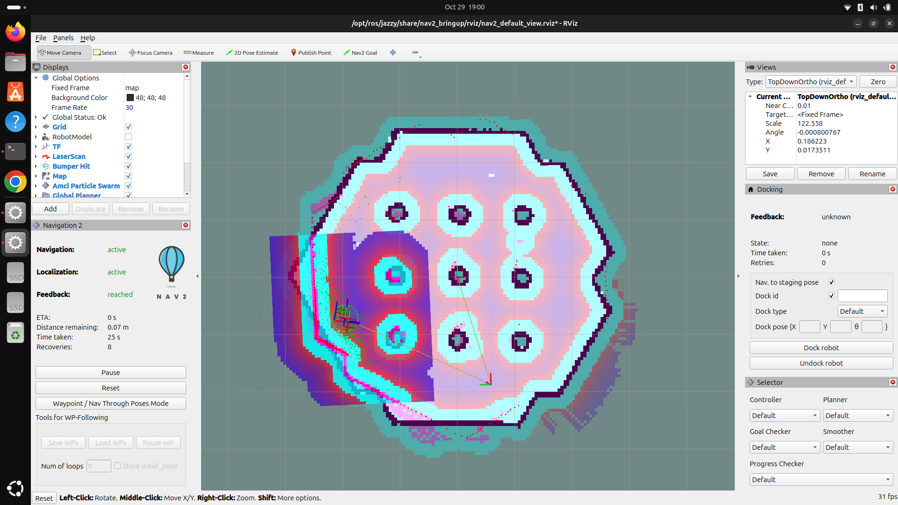
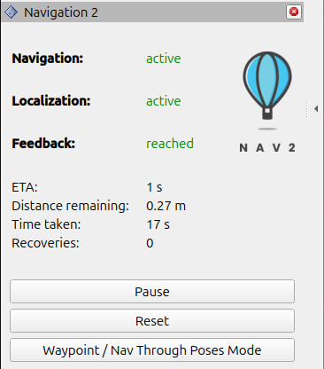

# TurtleBot3 Autonomous Navigation with ROS 2 Nav2


A simulation-based demonstration of autonomous mobile robot navigation using **TurtleBot3 Waffle, ROS 2 Jazzy, Gazebo Sim, RViz2 and Navigation2 (Nav2)**.


 **Implementation approach:** The project uses existing ROS 2 and Nav2 packages, launch files and navigation components. No custom path-planning or obstacle-avoidance algorithm was developed; the assignment explicitly permits the use of existing packages and does not require custom navigation algorithms.

---

## 1. Assignment Objective

Set up a TurtleBot3 robot in Gazebo with the ROS 2 Navigation2 (Nav2) stack and demonstrate autonomous navigation in an environment with obstacles.

### Tasks

1. Set up TurtleBot3 in a Gazebo simulation environment.
2. Configure Nav2 to navigate autonomously to a goal while avoiding obstacles.

The work focuses on bringing up the existing software stack, initializing localization, sending navigation goals, observing the resulting robot motion and recording the test outcomes.

## 2. Project Scope

The implementation covers:

- Launching the provided TurtleBot3 simulation in Gazebo.
- Visualizing the robot, map and navigation information in RViz2.
- Initializing the robot's estimated pose using **2D Pose Estimate**.
- Activating the Nav2 navigation stack.
- Sending navigation goals using the **Nav2 Goal** tool in RViz2.
- Observing the planned path and costmap visualizations.
- Testing navigation-goal completion in the obstacle-containing simulation world.

The project does not introduce a custom robot model, custom planner, custom controller or custom obstacle-avoidance algorithm.

## 3. Technology Stack

| Component | Technology |
|---|---|
| Operating system | Ubuntu 24.04 LTS |
| Robotics middleware | ROS 2 Jazzy Jalisco |
| Simulated robot | TurtleBot3 Waffle |
| Simulation | Gazebo Sim |
| Navigation framework | Navigation2 (Nav2) |
| Visualization | RViz2 |
| Localization | AMCL (Adaptive Monte Carlo Localization) |

## 4. System Architecture

The diagram below summarizes the data and control flow between the simulation, ROS 2, Nav2 and RViz2.

<p align="center">
  
</p>

### Component Responsibilities

- **Gazebo Sim:** Simulates the TurtleBot3 robot, its sensors, the world and obstacles.
- **ROS 2:** Provides communication through topics, messages and TF transforms between the simulation and navigation components.
- **AMCL:** Estimates the robot's pose relative to the supplied map after an initial pose is provided.
- **Nav2:** Executes navigation goals using its configured localization, planning, costmap and controller components.
- **RViz2:** Provides the interface for setting the initial pose and navigation goal, and for visualizing the map, planned path, costmaps and navigation feedback.

## 5. Installation

### 5.1 Source ROS 2 Jazzy

Open a terminal and run:

```bash
source /opt/ros/jazzy/setup.bash
```

Verify the active ROS distribution:

```bash
echo $ROS_DISTRO
```

Expected output:

```text
jazzy
```

### 5.2 Install Nav2 and the simulation packages

Update the package index:

```bash
sudo apt update
```

Install the packages used by the Nav2 Jazzy TurtleBot3 quickstart:

```bash
sudo apt install \
  ros-jazzy-navigation2 \
  ros-jazzy-nav2-bringup \
  'ros-jazzy-nav2-minimal-tb*'
```

### 5.3 Verify the Nav2 installation

```bash
source /opt/ros/jazzy/setup.bash
ros2 pkg prefix nav2_bringup
```

A successful command prints the installed location of the `nav2_bringup` package.

## 6. Launch the Simulation

Open a terminal and execute:

```bash
source /opt/ros/jazzy/setup.bash

ros2 launch nav2_bringup tb3_simulation_launch.py headless:=False
```

This is the launch command used for the working simulation. It starts the provided TurtleBot3 simulation and the associated Nav2 workflow, including Gazebo and RViz2.

Wait for both graphical applications and the navigation components to initialize. Keep the launch terminal open while using the simulation.

**Expected result:**

- Gazebo displays the TurtleBot3 simulation world.
- RViz2 displays the map and navigation visualization.
- Localization and navigation components initialize.

If the RViz2 Navigation 2 panel presents a **Startup** button, use it to activate the navigation lifecycle components when required by the running launch.

## 7. Autonomous Navigation Procedure

### 7.1 Initialize the robot pose

The robot needs an approximate initial position and orientation on the map.

1. Identify the TurtleBot3 robot's position and orientation in Gazebo.
2. Switch to RViz2.
3. Select **2D Pose Estimate** from the top toolbar.
4. Click the corresponding approximate position on the map.
5. Drag the arrow in the direction the robot is facing.
6. Release the mouse button.
7. Wait for localization to initialize.

Confirm that RViz2 reports a healthy Global Status and that the Localization and Navigation indicators are active.

### 7.2 Send a navigation goal

1. Select **Nav2 Goal** from the RViz2 toolbar.
2. Click a reachable, unoccupied location on the map.
3. Drag to specify the desired final orientation.
4. Release the mouse button to submit the navigation goal.

### 7.3 Observe navigation

Observe Gazebo and RViz2 while the goal is being executed:

- RViz2 displays the planned path and costmap information.
- Gazebo displays the simulated robot's actual movement.
- Nav2 executes the goal without requiring manual keyboard teleoperation.

### 7.4 Verify goal completion and obstacle handling

Check the Navigation 2 feedback panel for the reported goal status.

For an obstacle-avoidance test, select a reachable goal that requires a route around an obstacle in the simulation world. Observe the complete movement in Gazebo and check that the robot does not collide with the obstacle.

A final `reached` status is evidence of goal completion; by itself, it does not prove that the entire trajectory was collision-free. The full screen recording should therefore show the robot's movement during the test.

## 8. Verification and Diagnostic Commands

Open a second terminal while the simulation is running.

Source ROS 2 Jazzy:

```bash
source /opt/ros/jazzy/setup.bash
```

### Inspect running ROS 2 nodes

```bash
ros2 node list
```

### Inspect relevant topics

```bash
ros2 topic list | grep -E 'scan|odom|map|tf|cmd_vel'
```

### Check LiDAR publication

```bash
ros2 topic hz /scan
```

### Check odometry publication

```bash
ros2 topic hz /odom
```

Press `Ctrl+C` to stop each publication-rate check after observing it for a few seconds.

Topic names can vary with the launch configuration. Use `ros2 topic list` to identify the topics actually available in the running system.

## 9. Testing and Observations

The simulation was launched successfully, the initial pose was set through RViz2, and Nav2 reported successful completion of multiple navigation goals.

The following values were observed in the Navigation 2 feedback panel during separate runs:

| Run | Nav2 feedback | Time taken | Recoveries | Distance remaining shown |
|---|---|---:|---:|---:|
| 1 | Reached | 34 s | 11 | 0.00 m |
| 2 | Reached | 13 s | 0 | 0.26 m |
| 3 | Reached | 17 s | 0 | 0.27 m |
| 4 | Reached | 25 s | 0 | 0.07 m |

**Interpretation:** These are readings recorded from separate navigation attempts, not a controlled performance benchmark. The feedback panel reported `reached` in each recorded run. The distance-remaining values are reproduced as displayed by the panel and are not presented as independent measurements of final position accuracy. Recovery counts varied between runs.

The costmap and navigation screenshots in this repository provide supporting visual evidence. The accompanying 1–2 minute screen recording should be used to assess the complete obstacle-avoidance trajectory and confirm collision-free movement.

## 10. Screenshots and Visual Evidence

The following screenshots were captured during setup and navigation testing.

### 10.1 Gazebo simulation environment

The Gazebo view shows the simulated world, ground plane and obstacle arrangement used for the TurtleBot3 navigation exercise.

<p align="center">
  
</p>

### 10.2 TurtleBot3 Waffle model in Gazebo

The Gazebo entity panel identifies the simulated robot model as `turtlebot3_waffle`.

<p align="center">
  
</p>

### 10.3 RViz2 navigation visualization and costmaps

The RViz2 screenshot shows the map, obstacle and costmap visualizations, and the Navigation 2 status panel after a navigation attempt.

<p align="center">
  
</p>

### 10.4 Nav2 goal-completion feedback

The Navigation 2 panel below records an active navigation and localization state, with feedback reported as `reached`.

<p align="center">
  
</p>

## 11. Troubleshooting

| Issue | Recommended action |
|---|---|
| `nav2_bringup` package not found | Source ROS 2 Jazzy and verify that the package is installed. |
| RViz2 Fixed Frame error | Check that the `map` transform is available and initialize the robot's pose. |
| Navigation remains inactive | Check the launch terminal, set the initial pose and use the RViz2 Startup control if available. |
| Robot does not move after goal submission | Check navigation activation, localization, goal validity and the velocity-command path. |
| Planned path appears to intersect an obstacle | Check map/world consistency and the navigation costmaps. |
| LiDAR data is unavailable | Inspect the available scan topics and verify message publication. |

## 12. References

1. [Navigation2 — Jazzy Quickstart](https://docs.nav2.org/jazzy/getting_started/quickstart/quickstart/)
2. [Navigation2 — First-Time Robot Setup Guide](https://docs.nav2.org/jazzy/configuration_and_development/first_time_robot_setup_guide/)
3. [ROS 2 Jazzy — Ubuntu Installation Guide](https://docs.ros.org/en/jazzy/Installation/Ubuntu-Install-Debs.html)
4. [Navigation2 Documentation](https://docs.nav2.org/)

